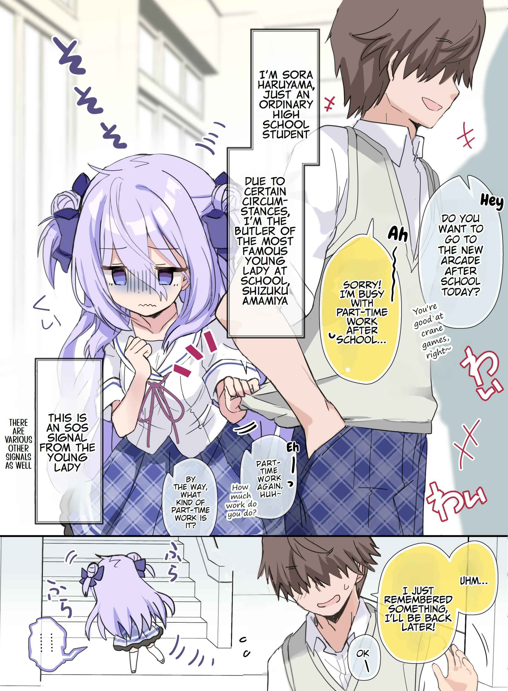
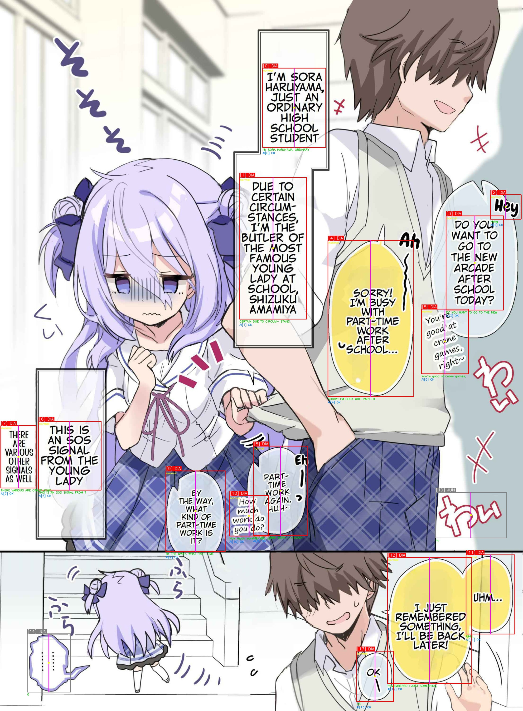
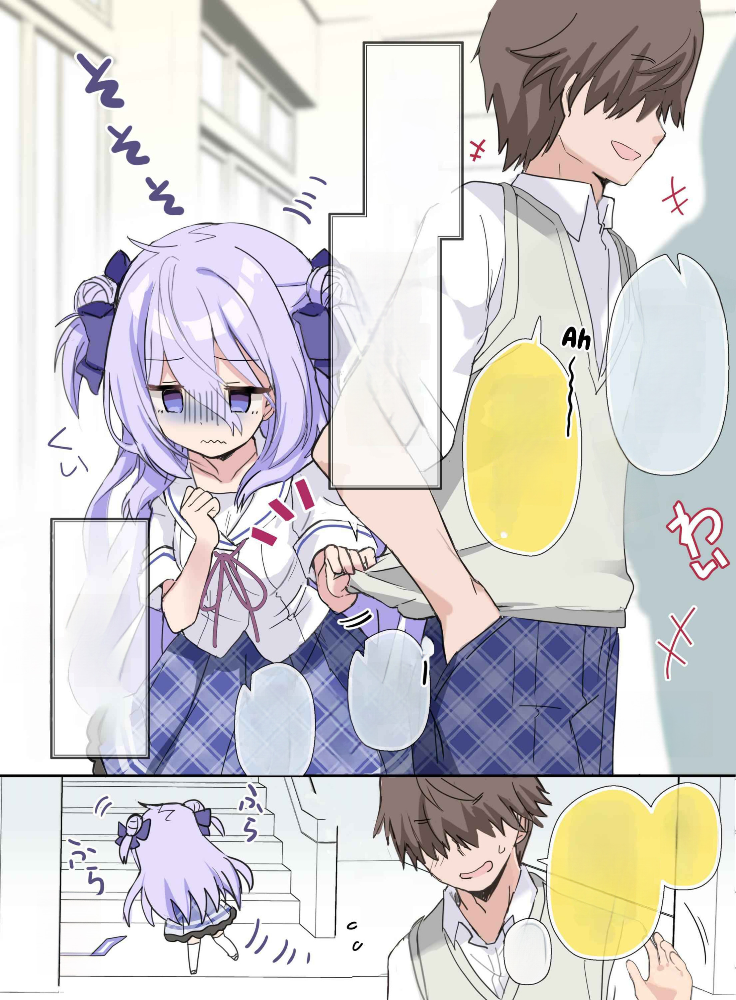
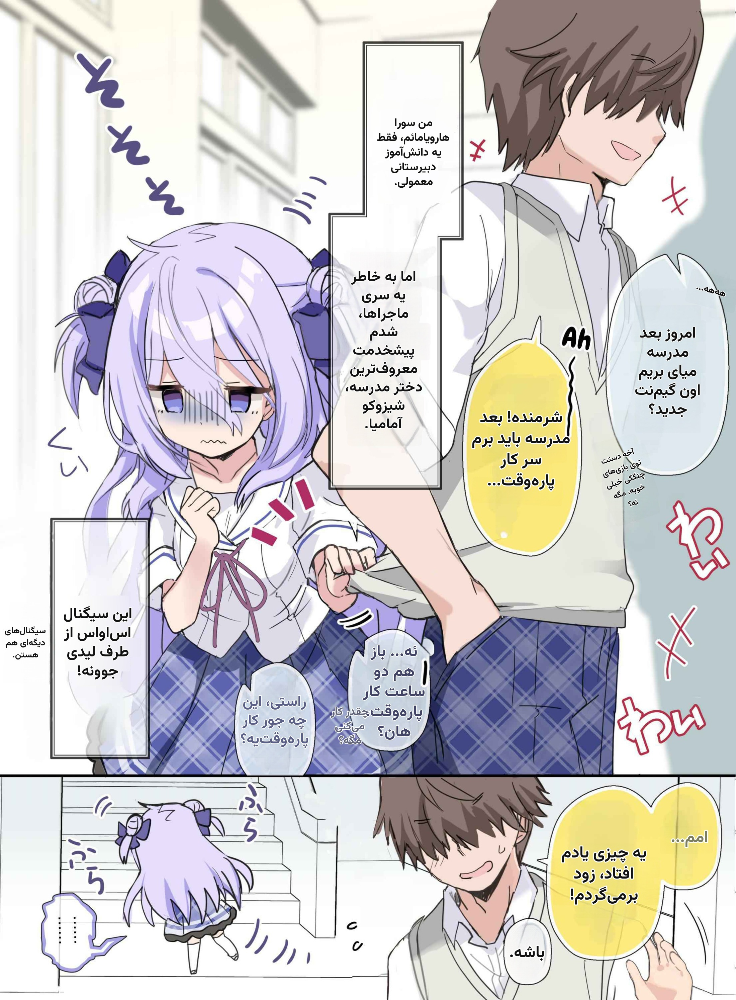

# مترجم خودکار مانگا / مانهوا (فارسی)

[](https://colab.research.google.com/github/amirwolf5122/Manga-AutoTranslate/blob/main/Manga_Translator_Colab.ipynb)
[](https://molab.marimo.io/github/amirwolf5122/Manga-AutoTranslate/blob/main/Manga-AutoTranslate.py/server)
[](https://amirwolf512-manga-autotranslate.hf.space/)
[](https://www.python.org/downloads/)
[](LICENSE)


ترجمهٔ خودکار صفحات مانگا و مانهوا به **فارسیِ محاوره‌ای**: متن را با OCR می‌خواند، فقط حروف را از داخل حباب پاک می‌کند (بدون آسیب به هنر)، با Gemini یا هر سرویس دلخواه ترجمه می‌کند و متن فارسی را با فونتِ متناسبِ لحن، داخل همان حباب می‌نویسد.

**در یک نگاه:** ورودی (پوشه/عکس/ZIP/PDF/URL) → تشخیص حباب (RT-DETR) → OCR (Paddle/Rapid) → ترجمهٔ کل فصل در یک درخواست (استریم) → پاکسازی دو-عکسی → رندر فارسی → خروجی **PDF / ZIP / HTML / PSD**

---

## نمونه خروجی

| قبل | دیباگ | پاکسازی | بعد |
|---|---|---|---|
|  |  |  |  |

---

## امکانات کلیدی

**ترجمه**
- همهٔ متن‌های فصل در **یک درخواست** با استریم و پیش‌نمایش زندهٔ «X/Y دیالوگ»
- **بریف داستان** (`--brief`): قبل از ترجمه، AI یک‌بار کل فصل را می‌خواند و خلاصهٔ داستان + لحن شخصیت‌ها را می‌سازد تا لحن‌ها ثابت بمانند
- **واژه‌نامهٔ اسامی** (`--glossary`): معادل‌های قفل‌شده (هر خط `English=فارسی`)؛ اسم‌های جدیدی که AI پیدا کند خودکار یادشان می‌ماند و فصل بعد خودش خوانده می‌شود
- **حالت ضدسانسور** (`--safety-settings`): فیلترهای ایمنی گوگل را BLOCK_NONE می‌کند — خشونت و فحش با شدت اصلی برمی‌گردد، بدون `[CENSORED]`
- **تفکر عمیق** (پیش‌فرض روشن، `--no-deep-thinking` برای خاموشی): Gemini → thinkingLevel=high؛ سرویس‌های OpenAI-سازگار → reasoning_effort=high
- **فرمت فشردهٔ خروجی** به سبک K3 v4.4 (responseSchema اجباری): ~۲۲٪ توکن ورودی کمتر، ~۵۴٪ توکن خروجی کمتر → سریع‌تر و پایدارتر
- سبک پرامپت: `professional` (پیش‌فرض) / `lite` — قابل ویرایش کامل (`--instruction`)
- لنگرِ سبک + ضدِ فیک (پاسخ‌های جای‌نگهدار رد و دوباره پرسیده می‌شوند)
- Temperature / Top-P قابل تنظیم

**مدیریت API**
- چرخش خودکار **چند کلید** و **چند مدل** (لیست با کاما = زنجیرهٔ فال‌بک)
- ضدلیمیت Gemini: پیسینگ نرخ + تشخیص سهمیهٔ روزانه + دکمهٔ ↻ برای لیست مدل‌های **رایگانِ** زنده
- ارائه‌دهنده‌ها: **Gemini + سرویس دلخواه (custom)** در همهٔ رابط‌ها؛ در CLI: OpenAI, DeepSeek, Groq, xAI, Together, OpenRouter, Ollama هم
- custom هر ۴ فرمت API را از روی لینک می‌شناسد: OpenAI Chat / OpenAI Responses / Anthropic / Google Generative AI

**پاکسازی (سبک دو-عکسی)**
- خروجی هرگز مستقیم اینپینت نمی‌شود: نسخهٔ اول خوب پاک می‌شود → نواحی متن **خط‌به‌خط** به نسخهٔ دوم (خروجی) منتقل می‌شوند → هنر و دیوار حباب **بیت‌به‌بیت همان عکس اصلی** می‌ماند
- پلکانِ خودکار: پرکردن صاف → LaMa (پچ‌به‌پچ) → OpenCV؛ یکسان روی GPU / CPU / گوشی
- ماسک فقط حروف؛ دور دوم جارو (لاتین + CJK)؛ گیتِ شاهدِ متن (جای بی‌متن هرگز اینپینت نمی‌شود)

**رندر فارسی**
- فونت جداگانه برای هر لحن (فریاد/زمزمه/فکر/system/…)؛ اندازه از ارتفاع واقعی خطوط OCR
- متن چرخیده و تیترهای **خمیده (قوسی)** با قوس واقعی
- پنجرهٔ سیستم (Status/Quest) خط‌به‌خط با فونت مخصوص

**سایر**
- کشِ مرحله‌ای: هر چیزی عوض شود فقط همان بخش دوباره اجرا می‌شود؛ «ادامهٔ هوشمند» با عوض‌شدن مدل/پرامپت/بریف/واژه‌نامه
- زبان OCR: انگلیسی / کره‌ای / ژاپنی / چینی (هر ترکیب)
- ورودی چندفصل: `*` همه | `,` چند لینک | `1 > 14.jpg` بازه از اول | `1 < 14.jpg` از آخر
- دیباگ (مربع رنگی + خروجی دیباگ)، خوانندهٔ زنده با مقایسهٔ قبل/بعد، هم‌خوانِ نکو-گرِل
- همهٔ متن‌های رابط در یک فایل: `manga_sections/05_ui_texts.py`

---

## اجرا

| روش | لینک / دستور |
|---|---|
| **Hugging Face** (پیشنهادی) | [amirwolf512-manga-autotranslate.hf.space](https://amirwolf512-manga-autotranslate.hf.space/) |
| **Google Colab** (پیشنهادی) | [باز کردن نوت‌بوک](https://colab.research.google.com/github/amirwolf5122/Manga-AutoTranslate/blob/main/Manga_Translator_Colab.ipynb) → `!bash manga.sh` |
| **Molab Marimo** (پیشنهادی) | [باز کردن](https://molab.marimo.io/github/amirwolf5122/Manga-AutoTranslate/blob/main/Manga-AutoTranslate.py/server) → `bash manga.sh` |
| **اپ اندروید** | [دانلود APK از Releases](https://github.com/amirwolf5122/Manga-AutoTranslate/releases/tag/apks) (arm64 / armv7a / universal) — راهنما: [`android/README.md`](android/README.md) |
| **GitHub Codespaces / Actions** | `bash manga.sh` — لینک عمومی خودکار (وبِ موقت) |
| **لوکال** | پایین ⬇ |

```bash
git clone https://github.com/amirwolf5122/Manga-AutoTranslate.git
cd Manga-AutoTranslate
Manga.bat        # ویندوز — منو: App / Web / CLI
bash manga.sh    # لینوکس / مک

# یا مستقیم:
python manga_app.py --web      # رابط وب
python manga_app.py            # پنجرهٔ دسکتاپ / تشخیص خودکار
python manga_app.py --cli      # CLI تعاملی
```

محیط‌های پشتیبانی‌شده: ویندوز / لینوکس / مک (پنجرهٔ نیتیو) · Colab / Molab / Codespaces / Actions (وب + لینک عمومی) · اندروید

---

## پارامترهای مهم (CLI)

| پارامتر | توضیح | پیش‌فرض |
|---|---|---|
| `-i` / `-o` | ورودی / خروجی (`.pdf` `.zip` `.html` `.psd`) | اجباری |
| `--font` | فونت فارسی | اجباری |
| `--api-key` | کلید API (چندتایی با کاما = چرخش) | یا env `GEMINI_API_KEY` |
| `--model` | لیست مدل‌ها با کاما = فال‌بک خودکار | لیست رایگان Gemini |
| `--provider` | gemini / custom (+ سایر در CLI) | gemini |
| `--api-base` | دامنهٔ سرویس custom | — |
| `--ocr-lang` | en / ko / ja / zh (چندتایی) | en |
| `--brief` | بریف داستان قبل از ترجمه | خاموش |
| `--glossary` | فایل واژه‌نامه `English=فارسی` | — |
| `--safety-settings` | ضدسانسور (BLOCK_NONE) | خاموش |
| `--deep-thinking` / `--no-deep-thinking` | تفکر عمیق | روشن |
| `--max-tokens` | سقف توکن خروجی: auto/8192/16384/32768/65536/custom | auto |
| `--temperature` / `--top-p` | خلاقیت مدل | 0.7 / 0.9 |
| `--prompt-mode` | professional / lite | professional |
| `--instruction` | فایل دستور مترجم (جایگزین کامل پرامپت) | — |
| `--clean-method` | lama-manga / lama-big / opencv | lama-manga |
| `--clean-only` | فقط پاکسازی (بدون ترجمه و کلید) | — |
| `--fake-translate` | تست بدون API (متن الکی) | — |
| `--clean-sfx` | پاکسازی SFX و متن استایل‌دار بیرون حباب | خاموش |
| `--active-tones` | فقط لحن‌های مشخص فعال بمانند | — |
| `--gpu` / `--cpu` | انتخاب سخت‌افزار | خودکار |
| `--debug` | مربع رنگی + خروجی دیباگ | — |
| `--workers` / `--batch-workers` | ورکر موازی OCR / پاکسازی | 3 / 3 |
| `--max-retries` | حداکثر تلاش (پیمایش زنجیرهٔ مدل‌ها) | 8 |
| `--api-timeout` | تایم‌اوت درخواست (ثانیه) | 30 |
| `--no-resume` / `--translate-retranslate` | شروع دوباره / ترجمهٔ از نو | ادامه |

فونت‌های لحن: `--font-normal` · `--font-shout` · `--font-whisper` · `--font-thought` · `--font-system` · `--font-letter` · `--font-narrator` · `--font-free` و…

---

## لیمیت رایگان Gemini

هر مدل رایگان سهمیهٔ روزانه دارد (به‌ازای هر کلید). برنامه خودش مدیریت می‌کند: فاصلهٔ امن بین درخواست‌ها؛ روی 429 اول کلید بعدی، بعد مدل بعدی؛ خطای سهمیهٔ روزانه فوراً تشخیص داده می‌شود؛ چند کلید + لیست چند-مدلی = چند برابر سهمیه.

---

## ساختار کد

```
manga.py          لودرِ سبک — بدنهٔ موتور در manga_sections/ (۱۴ بخش)
manga_app.py      رابط وب (Gradio) + لانچر + خوانندهٔ زنده
android/          اپ اندروید (Kotlin + پل Python — همان موتور)
05_ui_texts.py    همهٔ متن‌های رابط و حرف‌های کاراکتر
```

موتور: تشخیص حباب (RT-DETR) + OCR (Paddle/Rapid) + ترجمه (API) + پاکسازی (LaMa/OpenCV) + رندر فارسی (reshaper + bidi)

---

## محدودیت‌ها

- تایتل‌های خیلی بزرگِ درهم‌با-نقاشی ممکن است کامل پاک نشوند؛ SFXهای هنری ترجمه نمی‌شوند (پاکسازی با `--clean-sfx`)
- روی CPU اینپینت LaMa کند است (نوارهای بلند باندبه‌باند)
- واترمارک‌های نصفه‌کاره گاهی به‌اشتباه دیالوگ تشخیص داده می‌شوند
- کیفیت ترجمه به مدل و OCR بستگی دارد؛ مدل‌های JSON-ناسازگار با `--max-retries` بیشتر امتحان شوند

---

## حمایت مالی

ヾ(•ω•`)o

**TON:** `UQBScvayaxagwTfRBhlLNaqw-sZuadlnBjSvn8OJz7XZJJzT`

**TRX:** `TMmLTaCjaW1L2xWZmpR2EBeNyCawCzEkwa`

---

## لایسنس

MIT — آزاد برای استفادهٔ شخصی و غیرتجاری. حقوق مانگا/مانهوا متعلق به ناشر و خالق اثر است؛ این ابزار فقط برای مطالعهٔ شخصی است.

**توسعه‌دهنده:** [amirwolf5122](https://github.com/amirwolf5122) · **تلگرام:** [@Amir_wolf512](https://t.me/Amir_wolf512)
